# TicketRush

A flash-sale ticketing system for events with limited seats. Buyers race for a small number of tickets when a sale opens; organizers create events and watch sales live. Every purchase is protected against overselling, and paid orders receive a QR ticket by email.

**1,000 buyers. 100 seats. The same second.** On production, 100 seats sold out in 3.6 s to 1,000 concurrent buyers with 0 errors and 0 oversold, verified in the database after every run.

| | |
| --- | --- |
| Live app | <https://ticketrush.naphat.online> |
| API | <https://api.ticketrush.naphat.online> |
| API docs | <https://api.ticketrush.naphat.online/system/docs/> |

<p align="center">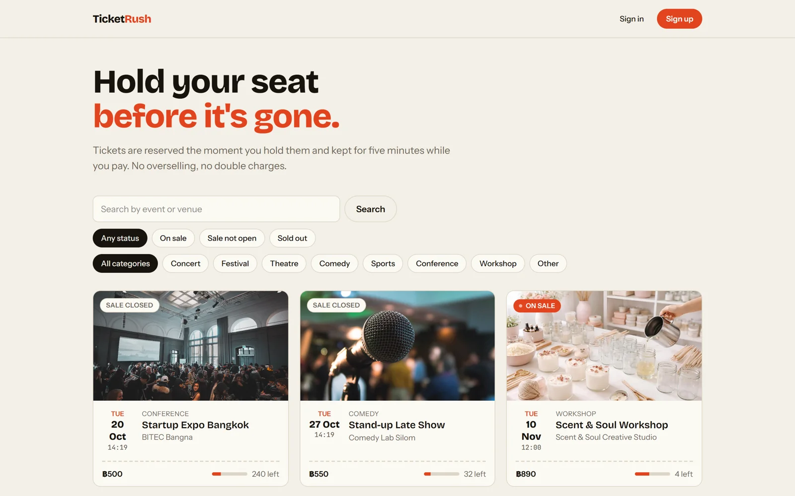</p>

The system design is in [docs/README.md](./docs/README.md), the failure table in [docs/fail-safe.md](./docs/fail-safe.md), and changes in [docs/CHANGELOG.md](./docs/CHANGELOG.md).

```text
backend/    Django API, Celery tasks, and tests
frontend/   Next.js app
loadtest/   Locust scenarios and recorded results
scripts/    Production smoke test
docs/       System design and diagrams
```

## Features

**Buyers**
- Browse events and search by title or venue, filtered by sale status and category.
- Hold seats for 5 minutes with a live countdown; stock returns automatically if the hold expires.
- Pay through a mock payment gateway that can inject faults on demand.
- Receive a QR ticket on the site and by email.

**Organizers**
- Create events with a fixed capacity and a sale window in the Django admin.

**Under the hood**
- Atomic stock reservation, compare-and-set state transitions, and idempotency keys on every mutating endpoint.
- Transactional outbox, separate Celery queues, signed and deduplicated webhooks, payment reconcile, and a circuit breaker on the gateway.
- One correlation ID per request across JSON logs, traces, and metrics in Grafana Cloud.
- Every merge to `main` deploys itself and ends with a smoke test that buys a real ticket.

| Event page | Mobile | API docs |
| --- | --- | --- |
| 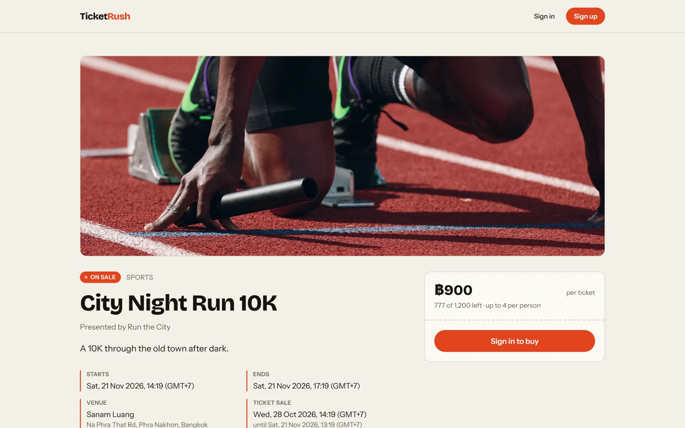 | 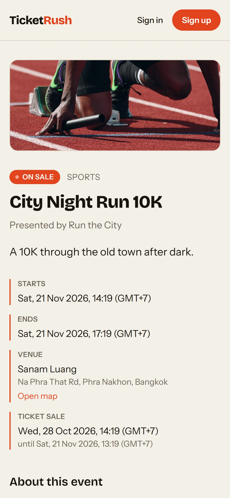 | 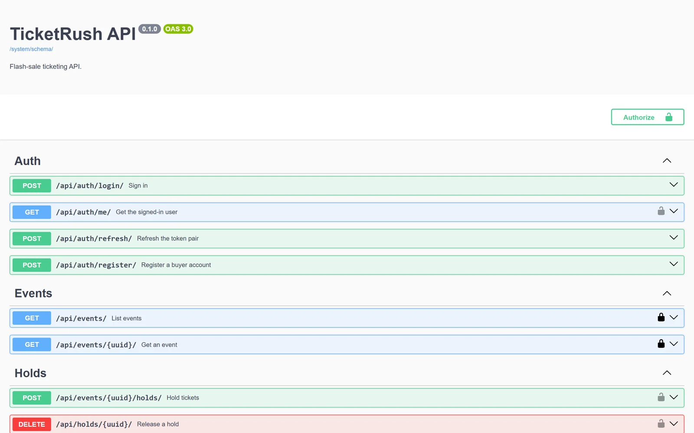 |

## How it works

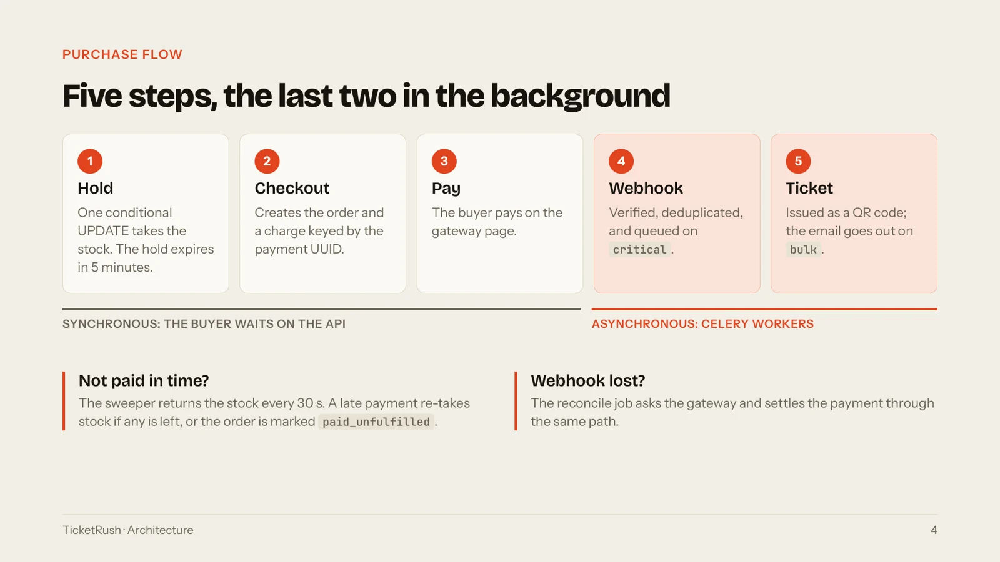

### Architecture

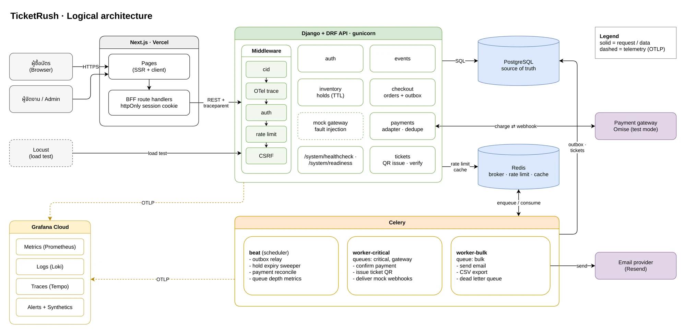

### Infrastructure and deployment

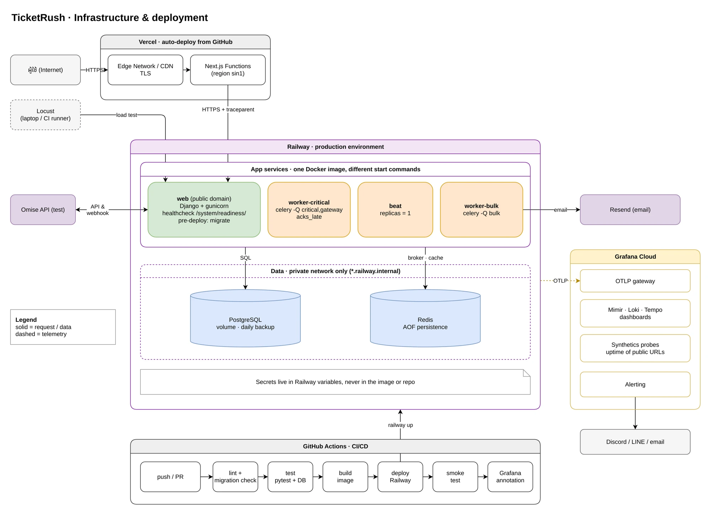

The draw.io sources, the [purchase sequence](docs/diagrams/purchase-sequence.drawio.svg), and the [data model](docs/diagrams/data-model.drawio.svg) are in `docs/diagrams/`.

## Design goals

### Never oversell

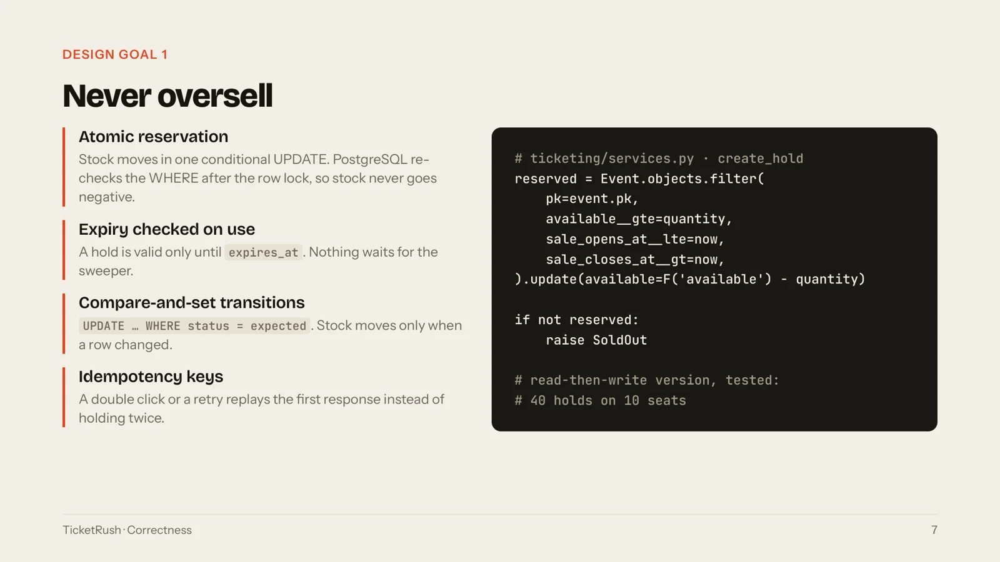

### Failures are handled, not hoped away

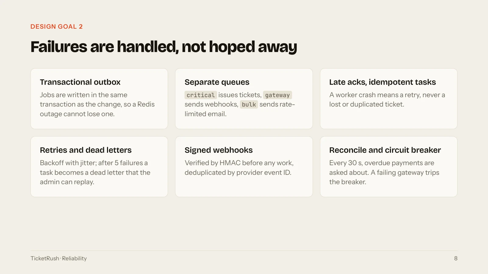

### Every request can be followed

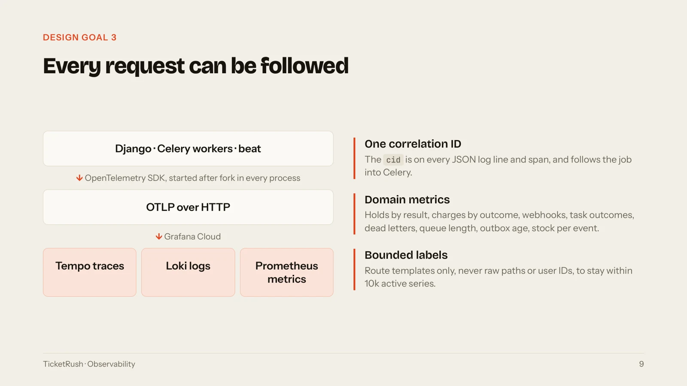

### Every merge to main deploys itself

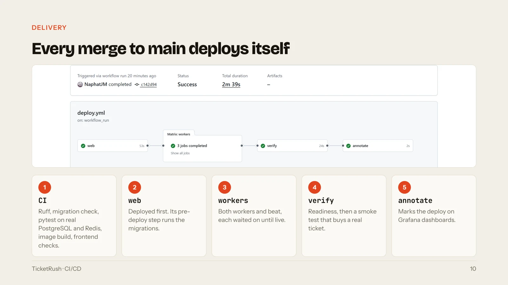

## Logging and monitoring

The backend keeps five kinds of records. Three are telemetry, streamed out of every process. Two are tables in PostgreSQL, browsable in the Django admin.

| # | Record | What it answers | Where it lives |
| --- | --- | --- | --- |
| 1 | Application logs | What happened in this process, and in which function? | stdout (Railway logs), and Grafana Loki when OTLP is enabled |
| 2 | Traces | Where did this request spend its time? | Grafana Tempo |
| 3 | Metrics | Is the system healthy right now? | Grafana Cloud Prometheus |
| 4 | API request log | What did this client send, and what did it get back? | `APIRequestLog` table |
| 5 | Activity log | Who changed what, when, and from where? | `ActivityLog` table |

### One ID across all of them

Every HTTP request gets a correlation ID (`cid`), returned in the `Correlation-ID` response header. The same `cid` is stamped on every log line, on the request's trace span, on its API request log and activity log rows, and on every Celery task the request causes. A buyer who reports an error can quote the `cid`, and that one value finds everything the request did, including the background work after the response. The frontend keeps the `cid` from each API error and logs it with the error code.

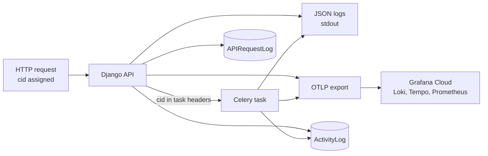

### 1. Application logs

Every process (web, both workers, and beat) writes one JSON object per line to stdout. Third-party loggers go through the same formatter, so no line ever lacks the `cid` or falls back to plain text.

| Field | Content |
| --- | --- |
| `ts`, `level`, `msg` | UTC timestamp in milliseconds, level, message |
| `service`, `env` | `OTEL_SERVICE_NAME` and `DJANGO_ENVIRONMENT` |
| `cid` | Correlation ID of the request, or of the request that queued the task |
| `logger`, `module`, `func`, `line` | Where the line was written |
| `trace_id`, `span_id` | The active span, so a log line opens its trace in Tempo |
| `celery_current_id`, `celery_parent_id` | Inside tasks: the ID of this task and of the task that queued it |
| `exc` | The traceback, when an exception is logged |
| any `extra=` key | Added at the top level, such as `http_status` or `duration_ms` |

```json
{"ts": "2026-10-31T02:00:01.123+00:00", "level": "WARNING", "service": "ticketrush-api", "env": "production",
 "cid": "6f1c0e2a9b4d4c55a1e7f3b2d8c90a41", "logger": "ticketing.views", "module": "logging", "func": "finalize_response",
 "line": 29, "msg": "response", "trace_id": "4bf92f3577b34da6a3ce929d0e0e4736", "span_id": "00f067aa0ba902b7",
 "http_method": "POST", "path": "/api/events/0192f.../holds/", "http_status": 409}
```

- Every API response is logged: 5xx at `ERROR`, 4xx at `WARNING`, and the rest at `DEBUG`.
- Service functions marked `@traced` log entry and exit with `duration_ms` at `DEBUG`, at the cost of one level check when `DEBUG` is off.
- `DJANGO_LOG_LEVEL` sets the level for the project's own loggers. Django logs from `WARNING` and Celery from `INFO`.
- Telemetry export failures are written to stdout and never exported, so a Grafana outage stays visible without feeding itself.

### 2. Traces

OpenTelemetry instruments Django, PostgreSQL (psycopg), Redis, Celery, and outgoing HTTP (urllib, used for Resend and webhook delivery). Trace context travels from the API into Celery tasks and into the mock gateway's webhook, so a payment can be followed in Tempo from the pay request through the webhook to the task that issues the tickets. Request spans carry the `cid` as an attribute. Health and readiness probes are not traced, since they arrive every few seconds and would bury real requests.

Exporters start after fork in every process (gunicorn `post_fork`, Celery `worker_process_init`, and `beat_init`) and flush when a Celery pool process exits. Export is asynchronous with bounded buffers: if Grafana Cloud is down, the app keeps serving and drops telemetry instead of blocking.

### 3. Metrics

| Metric | Labels | What it shows |
| --- | --- | --- |
| `http.server.request.duration` | method, status code, route template, error type | Latency and error rate per endpoint (buckets 25 ms to 5 s) |
| `ticketrush.hold.requests` | result: `ok`, `replayed`, or the error code | Hold outcomes during a sale, such as sold out or throttled |
| `ticketrush.gateway.charges` | provider, outcome: `ok`, `error`, `circuit_open` | Payment gateway health and circuit breaker trips |
| `ticketrush.gateway.charge.duration` | provider, outcome | Gateway latency |
| `ticketrush.webhooks.received` | provider, result: `accepted`, `duplicate`, `rejected` | Duplicate and forged webhooks |
| `ticketrush.task.outcomes` | task, outcome (the task's result, or `dead_letter`) | Background job results |

Beat runs as exactly one replica, so it also reports system-wide gauges once:

| Gauge | What it shows |
| --- | --- |
| `ticketrush.beat.publish_age` | Seconds since beat last sent a task; the outbox relay is due every 2 s, so a growing value means the scheduler is down |
| `ticketrush.celery.queue.length` | Tasks waiting in each queue: `critical`, `gateway`, `bulk` |
| `ticketrush.outbox.unpublished`, `ticketrush.outbox.oldest_age` | Outbox backlog and the age of its oldest row |
| `ticketrush.dead_letters.pending` | Dead letters not yet replayed |
| `ticketrush.webhooks.unprocessed` | Webhooks stored but not yet applied |
| `ticketrush.event.available` | Stock left per event on sale, by event UUID (at most 20 events) |

Labels use route templates and bounded values only, never raw paths or user IDs, to stay inside the Grafana Cloud free tier's 10k active series.

### 4. API request log

`APIRequestLog` stores one row for every write, every 4xx or 5xx response, and every request slower than `DJANGO_DRF_TRACKING_SLOW_MS` (2.5 s by default). Fast successful reads are skipped, so browse traffic during a sale does not double the database write load.

Each row holds the user, method, path, view, status code, response time, client IP, host, user agent, query parameters, request body, the response body for errors, the traceback for 5xx, and the `cid`. Passwords, tokens, secrets, keys, and signatures are replaced with `********` at any depth before the row is written. If the insert fails, the request still succeeds and the failure is logged.

### 5. Activity log

`ActivityLog` is the append-only business audit trail. Every state change writes its row inside the same transaction as the change, so an audit row exists exactly when the change committed: a rolled-back change leaves no row, and a failed audit write rolls the change back.

Each row holds the verb, the actor, the target model and its UUID, the `cid`, the client IP, and a JSON detail that never contains passwords, tokens, or payment data. Recorded verbs:

| Area | Verbs |
| --- | --- |
| Accounts | `user.registered` |
| Holds | `hold.created`, `hold.released`, `hold.expired` |
| Orders | `order.created`, `order.paid`, `order.payment_failed`, `order.paid_unfulfilled` |
| Operations | `dead_letter.replayed`, `mockdata.seeded`, `mockdata.purged` |

### Monitoring

- **Probes.** `/system/healthcheck/` for liveness, `/system/readiness/` as Railway's deploy gate, and the token-gated `/system/dependencies/` for PostgreSQL and Redis status. See the endpoint table under [Local development](#local-development).
- **Failure records in the admin.** Dead letters (with a replay action), outbox rows with their attempt count and last error, and webhook events with their processed time. Their counts are the beat gauges above.
- **Deploys.** Each deploy ends with a smoke test that buys a real ticket, and, when a Grafana token is configured, posts a success or failure annotation so a change in the graphs lines up with the release that caused it.

## Load test results

Every run targets production and ends with `loadtest_verify`, which runs up to 13 checks on stock, holds, orders, payments, tickets, outbox, and dead letters straight from PostgreSQL. Scenarios and how to run them are in [loadtest/README.md](./loadtest/README.md).

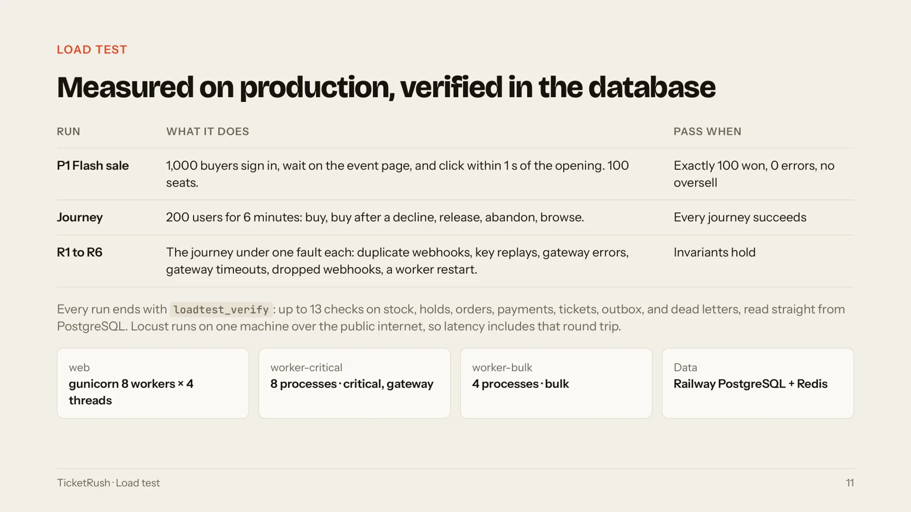

### P1 flash sale: 100 seats, 1,000 buyers

100 won a seat, 900 were told sold out, 0 errors, 0 oversold, across 90,420 requests.

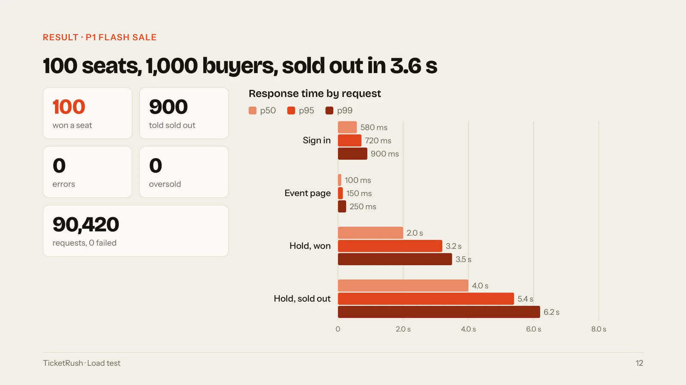

### Journey: from pay to ticket in 4.3 s

200 users bought, declined, released, and abandoned for 6 minutes at 175 req/s: 4,816 orders paid and ticketed, 0 failed of 62,964 requests.

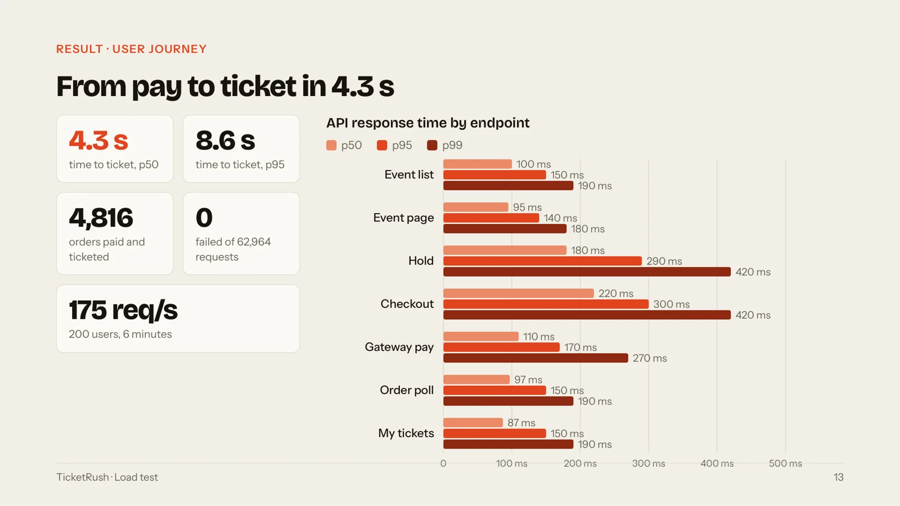

### Find the bottleneck, fix it, run it again

Moving webhooks off the email queue, polling orders with backoff, and recycling Gunicorn workers cut time to ticket from 29 s to 4.3 s at p50 and from 62 s to 9.7 s at p99.

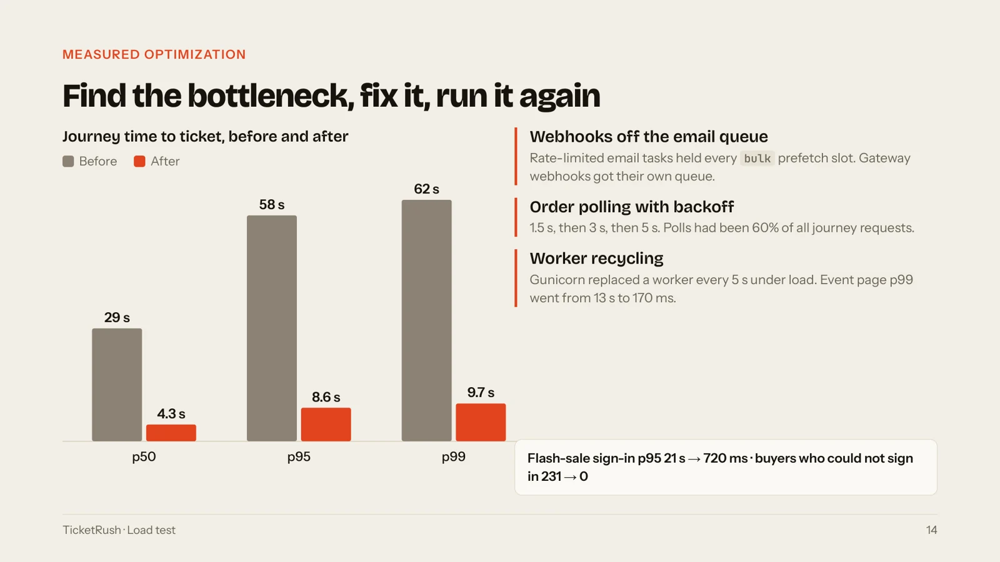

### Faults injected, invariants held

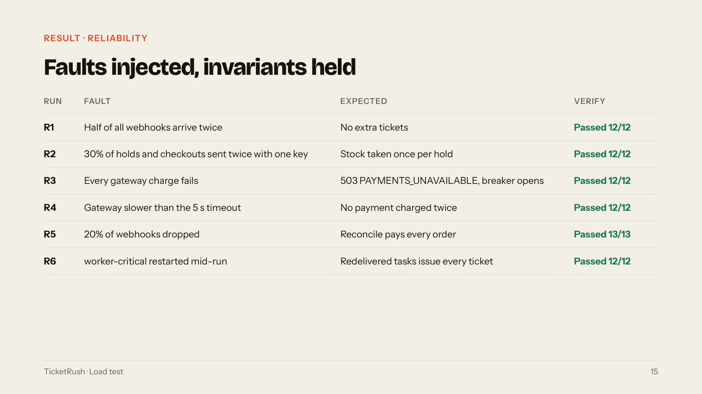

### What the load test found

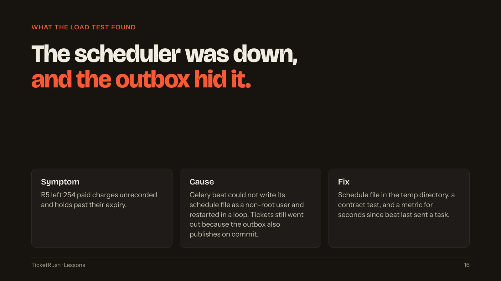

## Stack

Frontend: Next.js on Vercel. Backend: Django + Django REST Framework · Celery + Redis · PostgreSQL on Railway. Payments: mock gateway with fault injection. Email: Resend. Observability: OpenTelemetry · Grafana Cloud. Load testing: Locust. CI/CD: GitHub Actions.

## Local development

Requirements: Python 3.13 with [uv](https://docs.astral.sh/uv/), and Docker.

```bash
docker compose up -d --wait          # PostgreSQL and Redis
cd backend
cp .env.example .env
uv sync
uv run python manage.py migrate
uv run python manage.py runserver
```

| Command (in `backend/`) | Purpose |
| --- | --- |
| `uv run pytest` | Run the test suite against the local PostgreSQL and Redis |
| `uv run ruff check . && uv run ruff format --check .` | Lint and format check |
| `uv run celery -A ticketrush worker -Q critical,gateway,bulk -l info` | Run a Celery worker (add `--pool=solo` on Windows) |
| `uv run celery -A ticketrush beat -l info` | Run the scheduler for the outbox relay, hold sweeper, payment reconcile, and token cleanup |
| `uv run python manage.py seed_mockdata [--buyers N]` | Create the demo catalog (14 small and medium events in every sale status) and optional load-test buyers `mock-buyer-00001`...; safe to rerun |
| `uv run python manage.py purge_mockdata [--dry-run]` | Delete the demo catalog with everything bought on it and the mock users, for a clean load-test run |

Environment variables are listed in [backend/.env.example](./backend/.env.example). Django reads only `DJANGO_`-prefixed variables.

| Endpoint | Purpose |
| --- | --- |
| `/system/healthcheck/` | Liveness; touches no dependency |
| `/system/readiness/` | Deploy gate; checks PostgreSQL |
| `/system/dependencies/` | PostgreSQL and Redis status; needs `X-Readiness-Token` or a staff session |
| `/system/docs/` | OpenAPI documentation |
| `/api/` | Auth, events, holds, checkout, orders, tickets, and payment webhooks; see `/system/docs/` |
| `/admin/` | Django admin for organizers |

### Frontend

Requirements: Node.js 24 and pnpm 10. The Next.js app talks to the API only from the server: route code and server actions hold the JWTs in an encrypted, httpOnly session cookie, so the browser never sees a token.

```bash
cd frontend
cp .env.example .env.local
pnpm install
pnpm dev                             # http://localhost:3000
```

| Command (in `frontend/`) | Purpose |
| --- | --- |
| `pnpm lint` | ESLint |
| `pnpm typecheck` | Generate route types and run the TypeScript check |
| `pnpm build` | Production build |

Environment variables are listed in [frontend/.env.example](./frontend/.env.example). `BFF_SHARED_SECRET` must match `DJANGO_BFF_SHARED_SECRET` on the API, or every buyer is throttled under the frontend server's IP.

### Smoke test

```bash
python scripts/smoke_test.py [--api URL] [--event UUID]
```

Buys one ticket end to end against a live API (production by default): register, hold with a key replay, checkout, mock payment, and the ticket. It needs only the Python standard library and exits 1 on the first failed step. Each run leaves a user and a paid one-ticket order, so pass `--event` with a mock event to keep real events' stock.

### Deploy

Pushes to `main` deploy through `.github/workflows/deploy.yml` once CI passes: `web` first (its pre-deploy command runs the migrations), then `worker-critical`, `worker-bulk`, and `beat`, each waited on until Railway reports it live, then a readiness wait and the smoke test. Railway autodeploy stays disabled on every service so a push deploys once.

| GitHub setting | Purpose |
| --- | --- |
| `RAILWAY_TOKEN` (secret) | Railway project token for the production environment |
| `GRAFANA_ANNOTATION_TOKEN` (secret, optional) | Grafana service account token; without it the annotation step is skipped |
| `GRAFANA_URL` (variable, optional) | Grafana stack URL, such as `https://<stack>.grafana.net` |
| `SMOKE_EVENT_UUID` (variable, optional) | Event the post-deploy smoke test buys from; point it at a mock event to keep real events' stock |

Roll back by redeploying the previous deployment in Railway.
