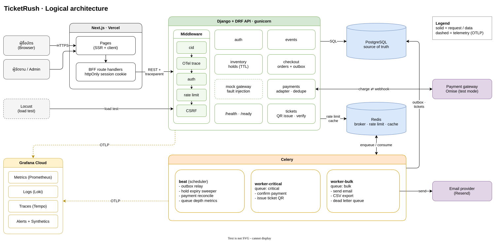
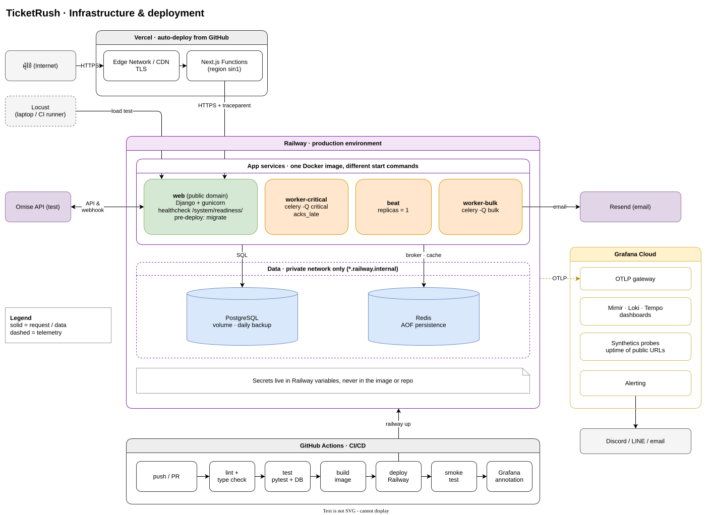
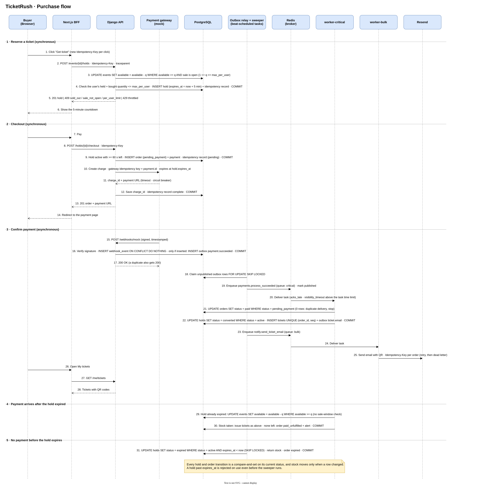
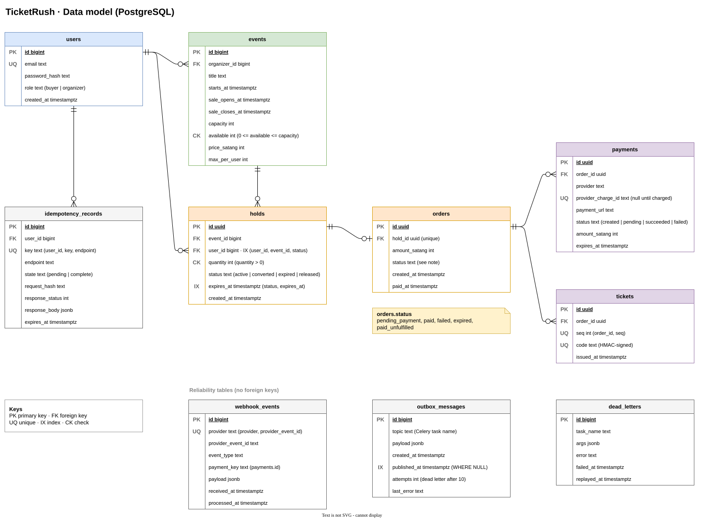

# TicketRush system design

TicketRush sells a small number of tickets to many buyers who arrive at the same moment. It must never oversell, must keep working when a dependency fails, and must show what happened to every request.

The domain is kept deliberately small. This document covers the backend underneath it: concurrency control, background jobs, failure handling, observability, and the delivery pipeline.

> **Status:** design phase. The sections below describe the target system. Items are checked off in the [roadmap](#roadmap) as they are built.

## How it works

1. An organizer creates an event with a fixed number of tickets and a sale start time.
2. When the sale opens, a buyer requests a ticket. The API reserves one with a **hold** that expires after 5 minutes. Each request carries an idempotency key, so a double click or a retry cannot reserve twice.
3. The buyer checks out. The API creates a charge through the payment gateway.
4. The gateway sends a signed webhook. A worker confirms the order, issues a QR ticket, and emails it.
5. If the buyer does not pay in time, a scheduled job releases the hold back into stock.

## Architecture

## Purchase flow

## Data model

`orders` reaches the buyer and the event through its hold, so it stores no copy of `user_id` or `event_id`. The reliability tables have no foreign keys: they record messages and failures, not domain state.

## Failure handling

The expected failure of every component, how it is detected, and how the system responds are listed in [fail-safe.md](fail-safe.md).

The `.drawio.svg` files embed their source, so they open for editing in [draw.io](https://app.diagrams.net). The `.drawio` files next to them hold the same diagrams.

## Tech stack

| Layer | Choice |
| --- | --- |
| Frontend | Next.js on Vercel, with route handlers as a backend-for-frontend (BFF) that keeps the session in an httpOnly cookie |
| API | Django + Django REST Framework, served by gunicorn |
| Background jobs | Celery workers and Celery beat, with Redis as the broker |
| Database | PostgreSQL |
| Payments | A gateway adapter with a built-in mock gateway that injects faults; an Omise test-mode adapter is planned |
| Email | Resend |
| Observability | OpenTelemetry to Grafana Cloud (Prometheus metrics, Loki logs, Tempo traces, alerting, synthetic checks) |
| Load testing | Locust |
| Hosting | Railway (API, workers, Postgres, Redis) and Vercel (frontend) |
| CI/CD | GitHub Actions |

## Design goals

**Never oversell.** Stock is reserved with an atomic conditional update in PostgreSQL. A hold is valid only until its `expires_at`, so an expired hold cannot be paid for even before the sweeper runs. Every hold and order transition is a compare-and-set on its current status, so a sweeper, a worker, and a buyer racing on the same hold cannot both move its stock.

**Background work that survives failure.** Domain changes and the jobs they trigger are written in the same transaction through an outbox table, so a Redis outage cannot lose a job. Tasks are idempotent and acknowledged late, so a worker crash causes a retry, not a lost or duplicated ticket. Ticket issuing and email run on separate queues, so a slow email provider cannot delay ticket confirmation.

**Expected failures are handled, not hoped away.** Every external call has a timeout, retries with exponential backoff and jitter, and a dead-letter queue for jobs that keep failing. Webhooks are verified by signature and deduplicated by event ID. A scheduled reconcile job settles payments whose webhook never arrived.

**Every request can be followed.** Each request gets a correlation ID (`cid`) that appears in every log line. A trace context propagates from the frontend through the API into Celery tasks. Logs are structured JSON and record what happened, in which function, and when.

**Performance is measured, not assumed.** Locust scenarios simulate a sale opening. Results are recorded with the metrics observed during the run, and each optimization is compared against that baseline.

## Roadmap

- [x] Architecture and infrastructure diagrams
- [x] Purchase-flow sequence diagram, data model, and failure-handling table
- [ ] Project skeleton deployed to Railway and Vercel
- [ ] Events, holds, checkout, and the oversell test under concurrency
- [ ] Celery jobs, outbox, payment webhooks, and ticket issuing
- [ ] Logging, tracing, metrics, dashboards, and alerts
- [ ] Frontend
- [ ] Security hardening
- [ ] Load test baseline and one measured optimization
- [ ] Full CI/CD pipeline: build, test, deploy, smoke test, monitor
